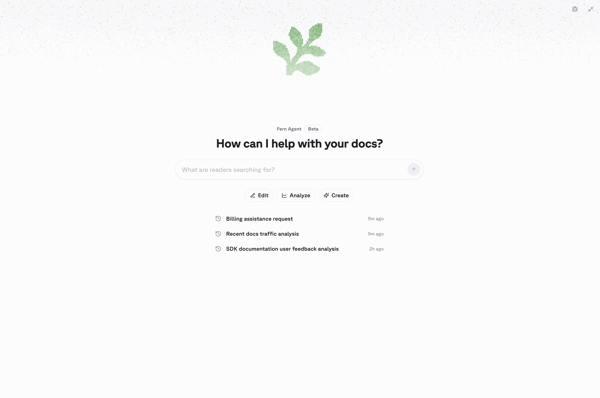
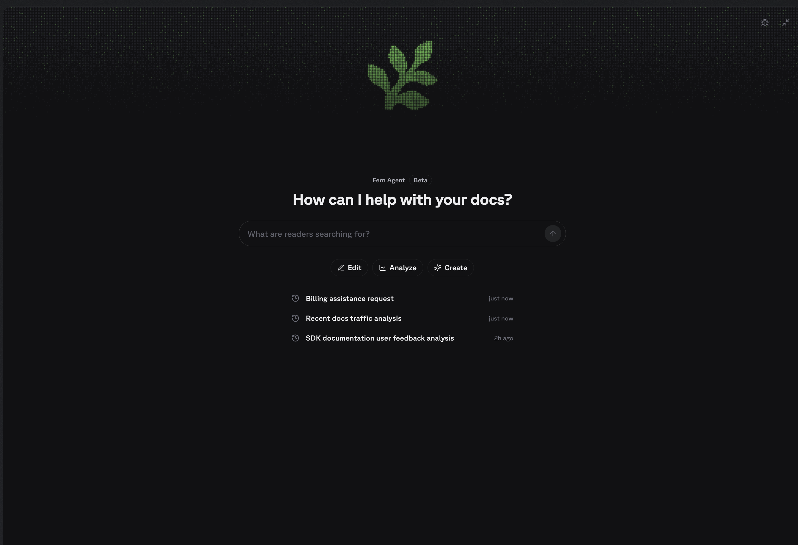

Fern hosts a private [Model Context Protocol (MCP)](https://modelcontextprotocol.io) server for your organization, with full context on Fern's documentation and configuration alongside your live Fern data. Register it with your coding agent to look up `docs.yml` syntax, components, and CLI commands while you build, and to read your sites, deployments, and reader activity without leaving your terminal.

**There are two Fern MCP servers.** This page covers the MCP server for *you* — the person building the docs site. It gives your coding agent access to Fern's product documentation and your organization's live data. If you want to give *your readers* an MCP server that answers questions about your product, see [MCP server for your site](/learn/docs/ai-features/mcp-server).

## What it can do

Each connection is scoped to a single organization, and the server returns only what your Fern account can already see. The server has access to the same tools as [Fern Agent](/learn/docs/ai-features/fern-agent), including:

- **Sites and configuration**: your docs sites, their `docs.yml` configuration and Dashboard settings, and the Markdown source of published pages
- **Deployments**: deployment history, and pull request status and preview URLs for connected repositories
- **Analytics**: traffic summaries, top pages, 404s, referring domains, and LLM bot traffic
- **Reader signals**: search queries, Ask Fern conversations and resolution rates, and page feedback
- **Members**: the people in your organization

## Setup

Open the [Fern Dashboard](https://dashboard.buildwithfern.com/). From the [Fern Agent chat panel](/learn/docs/ai-features/fern-agent), click **Onboard your agent** to connect your coding agent to the MCP server. 

<div className="dark:hidden">
  <Frame>
    
  </Frame>
</div>

<div className="hidden dark:block">
  <Frame>
    
  </Frame>
</div>

Alternatively, you can set it up directly from your terminal:

<CodeBlock title="terminal">
```bash
npm install -g fern-api
fern login
fern mcp install
```
</CodeBlock>

<Info>
  Agents load MCP servers at startup, so one registered mid-session becomes callable in the next session.
</Info>

### Multiple organizations

If your Fern account belongs to more than one organization, tool calls return the organization-scoped URLs to pick from. Pass `fern mcp install --org <org>` to pick one, or register again by hand with the URL you want:

<CodeBlocks>
<CodeBlock title="Claude Code">
```bash
claude mcp add --transport http fern-org https://fai.buildwithfern.com/organizations/{{YOUR_ORGANIZATION}}/mcp
```
</CodeBlock>
<CodeBlock title="Codex">
```bash
codex mcp add fern-org --url https://fai.buildwithfern.com/organizations/{{YOUR_ORGANIZATION}}/mcp
```
</CodeBlock>
<CodeBlock title="Cursor (.cursor/mcp.json)">
```json
{
  "mcpServers": {
    "fern-org": { "url": "https://fai.buildwithfern.com/organizations/{{YOUR_ORGANIZATION}}/mcp" }
  }
}
```
</CodeBlock>
<CodeBlock title="GitHub Copilot (.vscode/mcp.json)">
```json
{
  "servers": {
    "fern-org": { "url": "https://fai.buildwithfern.com/organizations/{{YOUR_ORGANIZATION}}/mcp" }
  }
}
```
</CodeBlock>
</CodeBlocks>

## Common questions

<AccordionGroup>
<Accordion title="How do I enable the MCP server for my docs site (for my readers)?">
That is a different server — see [MCP server for your site](/learn/docs/ai-features/mcp-server). It is automatically generated for every docs site with Ask Fern enabled. No configuration is needed to turn it on.
</Accordion>
<Accordion title="Is Fern's MCP server a separate paid add-on?">
No. Fern's MCP server (this page) is available to all Fern users at no extra charge. The [MCP server for your site](/learn/docs/ai-features/mcp-server) (for your readers) uses Ask Fern under the hood and consumes AI credits, which are included in every plan.
</Accordion>
</AccordionGroup>
