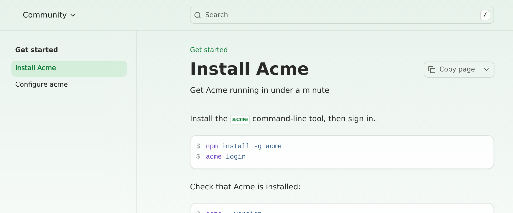
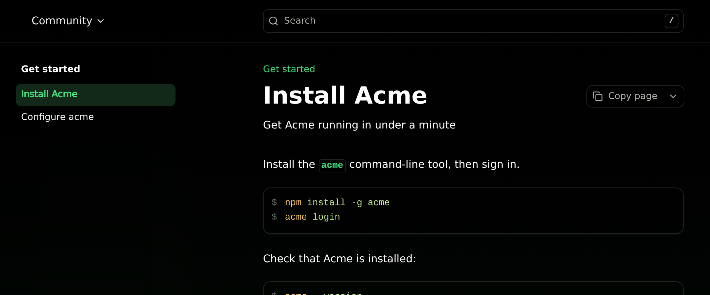
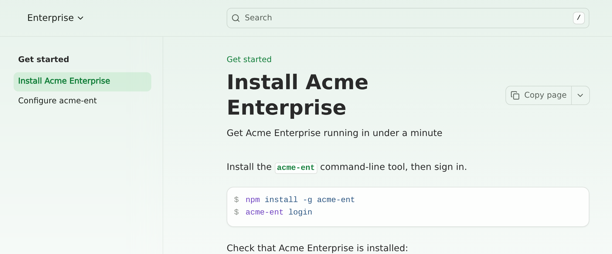
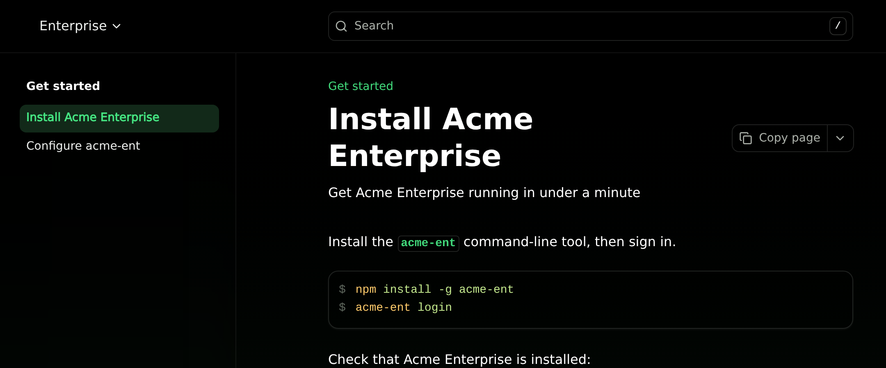

A profile is a named set of values, such as a product name or CLI command. Write `${NAME}` in a page, and Fern swaps in the value from the profile. Give each product, version, or tab its own profile, and one page shows the right values in every edition, with no copies to maintain.

## See it in action

This site has two products, Community and Enterprise, that share one install page.

<Steps>
<Step title="Define a profile for each product">

```yaml docs.yml
profiles:
  community:
    vars:
      PRODUCT: Acme
      CLI: acme
  enterprise:
    vars:
      PRODUCT: Acme Enterprise
      CLI: acme-ent

profile: community

products:
  - display-name: Community
    slug: community
    path: ./products/community.yml
  - display-name: Enterprise
    slug: enterprise
    path: ./products/enterprise.yml
    profile: enterprise
```

</Step>
<Step title="Write the page and its navigation once">

Both product files list the same pages, with placeholders in the sidebar titles.

<CodeBlocks>
````mdx pages/install.mdx
---
title: Install ${PRODUCT}
subtitle: Get ${PRODUCT} running in under a minute
---

Install the `${CLI}` command-line tool, then sign in.

```bash
npm install -g ${CLI}
${CLI} login
```

Check that ${PRODUCT} is installed:

```bash
${CLI} --version
```
````

```yaml products/community.yml
navigation:
  - section: Get started
    contents:
      - page: Install ${PRODUCT}
        path: ../pages/install.mdx
      - page: Configure ${CLI}
        path: ../pages/configure.mdx
```
</CodeBlocks>

</Step>
<Step title="Each product gets its own edition">

Fern builds the install page once per product. The title, subtitle, commands, and sidebar titles change with the profile.

<Tabs>
<Tab title="Community">
<div className="dark:hidden">
  <Frame>
    
  </Frame>
</div>
<div className="hidden dark:block">
  <Frame>
    
  </Frame>
</div>
</Tab>
<Tab title="Enterprise">
<div className="dark:hidden">
  <Frame>
    
  </Frame>
</div>
<div className="hidden dark:block">
  <Frame>
    
  </Frame>
</div>
</Tab>
</Tabs>

</Step>
</Steps>

## Define profiles

Add profiles to `docs.yml`, then select one with `profile`:

```yaml docs.yml
profiles:
  community:
    vars:
      PRODUCT: Acme
      CLI: acme
  enterprise:
    vars:
      PRODUCT: Acme Enterprise
      CLI: acme-ent

profile: community

products:
  - display-name: Community
    slug: community
    path: ./products/community.yml
  - display-name: Enterprise
    slug: enterprise
    path: ./products/enterprise.yml
    profile: enterprise
```

`vars` also accepts a path to a YAML file, or a list of paths. Paths are relative to `docs.yml`, and each file has a top-level `vars` map:

<CodeBlocks>
```yaml docs.yml
profiles:
  enterprise:
    vars:
      - ./vars/common.yml
      - ./vars/enterprise.yml
```

```yaml vars/enterprise.yml
vars:
  PRODUCT: Acme Enterprise
  CLI: acme-ent
```
</CodeBlocks>

A name defined in two files fails the build. Vars files are committed with your docs, so don't store secrets in them.

## Use placeholders

Write the page once:

```mdx install.mdx
---
title: Install ${PRODUCT}
---

Run `${CLI} install`.
```

When both product files list `install.mdx`, Fern builds one page per product, each at its own URL. Under Enterprise, the page reads "Install Acme Enterprise" and "Run `acme-ent install`".

Values fill page content and frontmatter, navigation titles, navbar links, the announcement banner, and footer text. Search, Markdown output, and [`llms.txt`](/learn/docs/ai-features/llms-txt) get the same filled text. Endpoint and webhook descriptions from an API definition aren't filled.

## Which profile applies

Set `profile` at the top level of `docs.yml` or on a product, version, tab, tab variant, section, or page. The closest one to a page wins: page, then section, tab variant, tab, version, product, and site.

A closer profile replaces the outer one entirely, including names it doesn't define. `fern check` reports a `profile` that names no entry in `profiles`.

## Escapes and missing values

- To show a literal `${NAME}`, write `\$\{NAME\}`.
- A placeholder whose name isn't in the applied profile stays as written.
- With [`substitute-env-vars`](/learn/docs/configuration/site-level-settings#settingssubstitute-env-vars) on, Fern fills a missing name from the environment variable with the same name. This also covers pages with no profile.
