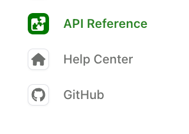

Tabs split a product or version into parallel bodies of content, each with its own sidebar. Tab variants give a single tab more than one version of its content, such as REST versus GraphQL or beginner versus advanced.

Two tabs make sense when the content is unrelated, like guides and an API Reference. Variants of one tab make sense when it covers the same ground for a different reader. A [tab menu](#tab-menus) collects several tabs under one header tab, such as a Products tab with one tab per product.

## Tabs

To configure tabs:

- Declare each tab under the top-level `tabs` key with a `display-name` and an `icon`.
- Reference the tab in `navigation` with `tab:`. Each tab requires either a `layout` for its content, `variants` for [tab variants](#tab-variants), or an `href` pointing at an external URL.

<CodeBlock>
{/* <!-- vale off --> */}

```yaml title="docs.yml"
tabs: # Declare each tab
  api: 
    display-name: API Reference
    icon: puzzle # Font Awesome icon
  help:
    display-name: Help center
    icon: ./assets/icons/help-icon.svg  # Custom image file
  github:
    display-name: GitHub
    icon: brands github # Font Awesome icon
    href: https://github.com/fern-api/fern
    target: _blank # Link opens in a new tab
    
navigation: # Reference each tab by its key
  - tab: api
    layout: 
      - section: Introduction
        contents: 
          - page: My page
            path: my-page.mdx
      - api: API Reference   
  - tab: help
    layout: 
      - section: Help center
        contents: 
          - page: Contact us
            path: contact-us.mdx
  - tab: github # External link, so no layout
```
{/* <!-- vale on --> */}
</CodeBlock>

<Frame>
  
</Frame>

<Note title="Tab icons">
<Markdown src="/products/docs/snippets/icons.mdx" />
</Note>

### Tabs placement and styling

Tabs display in the left sidebar by default. Use [`theme.tabs`](/learn/docs/configuration/site-level-settings#theme-configuration) to control placement, style, and alignment.

<CodeBlock title="docs.yml">
```yaml
theme:
  tabs:
    style: bubble        # "default" (underline) or "bubble" (pill-shaped)
    alignment: center    # "left" or "center" (center only applies to header tabs)
    placement: header    # "header" or "sidebar"
```
</CodeBlock>

### Tab properties

<ParamField path="display-name" type="string" required={true} toc={true}>
  The name shown in the tab header
</ParamField>

<ParamField path="icon" type="string" toc={true}>
  <Markdown src="/products/docs/snippets/icons.mdx" />
</ParamField>

<ParamField path="slug" type="string" toc={true}>
  Custom URL slug for the tab
</ParamField>

<ParamField path="skip-slug" type="boolean" toc={true}>
  Exclude the tab slug from URLs
</ParamField>

<ParamField path="hidden" type="boolean" toc={true}>
  Hide the tab from navigation. See [Hiding content](/learn/docs/navigation/hiding-content#hiding-a-section-tab-tab-variant-or-version) for details.
</ParamField>

<ParamField path="layout" type="list" toc={true}>
  Navigation structure for the tab's content. Required unless the tab uses `variants` or `href`.
</ParamField>

<ParamField path="variants" type="list" toc={true}>
  List of [tab variants](#tab-variants). Use instead of `layout`.
</ParamField>

<ParamField path="tab-menu" type="list" toc={true}>
  Turns the tab into a [tab menu](#tab-menus) of other tabs that opens from the header. Set on the tab's entry under `tabs`, not in `navigation`.
</ParamField>

<ParamField path="tab-menu-column-height" type="integer | &quot;no-limit&quot;" toc={true}>
  Maximum number of entries per column in the tab's menu. `no-limit` keeps a single column. Overrides [`layout.tab-menu.default-column-height`](/learn/docs/configuration/site-level-settings#layouttab-menudefault-column-height). Only applies when the tab has a `tab-menu`.
</ParamField>

<ParamField path="href" type="string" toc={true}>
  External URL. When set, clicking the tab redirects to this URL. Tabs with `href` must not include `layout` or `variants`.
</ParamField>

<ParamField path="target" type="string" toc={true}>
  Where the link opens. One of `_blank`, `_self`, `_parent`, or `_top`.
</ParamField>

<ParamField path="changelog" type="string" toc={true}>
  Path to a [changelog](/learn/docs/configuration/changelogs) folder, relative to the YAML file where it is set (e.g., `docs.yml`)
</ParamField>

<ParamField path="viewers" type="string | list" toc={true}>
  Role-based access control for the tab
</ParamField>

<ParamField path="orphaned" type="boolean" toc={true}>
  When true, roles don't inherit from parent elements
</ParamField>

<ParamField path="feature-flag" type="string | object" toc={true}>
  Conditional display configuration
</ParamField>

<llms-only>
### Common errors

#### Tab "X" is missing from the tabs configuration.

The [`navigation`](/learn/docs/configuration/navigation) list references a tab key that isn't declared under the top-level `tabs` object. Add the tab to `tabs:` in `docs.yml` (with at least a [`display-name`](#display-name)), or update the `- tab:` reference in `navigation` to match an existing key.

```yaml title="docs.yml"
tabs: # every tab referenced in `navigation` must be declared here
  api:
    display-name: API Reference
  help:
    display-name: Help center  

navigation:
  - tab: api
    layout: [...]
  - tab: help
    layout: [...]
```

#### Tab "X" has both a href and layout. Only one should be used.

A tab entry combines [`href`](#href) with [`layout`](#layout) or [`variants`](#variants). Use `href` for external links, or `layout`/`variants` for internal content — not both.

```yaml title="docs.yml"
tabs:
  github:
    display-name: GitHub
    href: https://github.com/fern-api/fern  # external link — no `layout` or `variants`

navigation:
  - tab: github
```

#### Tab "X" is missing a href, layout, or variants.

Every tab in [`navigation`](/learn/docs/configuration/navigation) must point somewhere. Add a [`layout`](#layout), [`variants`](#variants), or [`href`](#href) to the tab entry.

```yaml title="docs.yml"
navigation:
  - tab: api
    layout:  # points the tab at internal content
      - section: Introduction
        contents:
          - page: My page
            path: my-page.mdx
```

#### Tab "X" has a tab-menu, so its navigation entry can't also have a layout or variants.

The navigation entry of a [tab menu](#tab-menus) only sets where the menu sits in the header. Remove its `layout` or `variants` and put pages under each menu tab's own `- tab:` entry.

#### Tab "X" is in the tab-menu of "Y" but has no entry in navigation.

Every tab listed in a [`tab-menu`](#tab-menus) needs its own `- tab: X` entry in `navigation` with a `layout` or `variants`.

#### Tab "X" has a tab-menu, but header tabs are off.

Tab menus open from the header. Set `layout.tabs-placement: header` (or `theme.tabs.placement: header`); otherwise the menu's tabs show in a selector at the top of the sidebar.
</llms-only>

## Tab variants

To add variants to a tab:

- Replace the tab's `layout` with a `variants` list. The declaration under `tabs:` doesn't change.
- Give each variant a `title` and its own `layout`.

Variants [support RBAC](/learn/docs/authentication/features/rbac), so a variant can be limited to readers holding a given role.

```yaml title="docs.yml" startLine=16 {22-34}
tabs: 
  api: 
    display-name: API Reference
    icon: puzzle
  help:
    display-name: Help center
    icon: home
  github:
    display-name: GitHub
    icon: brands github
    href: https://github.com/fern-api/fern
    
navigation: 
  - tab: api
    layout: 
      - section: Introduction
        contents: 
          - page: My page
            path: my-page.mdx
      - api: API Reference   
  - tab: help
    variants: # Replaces this tab's layout
      - title: For developers # Each variant has its own title and layout
        layout:
          - section: Getting started
            contents:
              - page: Quick start
                path: ./pages/dev-quickstart.mdx
      - title: For product managers
        layout:
          - section: Getting started
            contents:
              - page: Overview
                path: ./pages/pm-overview.mdx
  - tab: github
```

<Frame>
  <video
    autoPlay
    muted
    loop
  >
    <source src="assets/merge-tab-variants.mp4" type="video/mp4" />
  </video>
</Frame>

### Variant groups and links

A `variants` list also accepts `group` entries and links. A group adds a header above its `items` in the variant selector, and a link (`link` and `href`) points at an external URL. Groups hold variants and links, not other groups.

```yaml title="docs.yml"
navigation:
  - tab: sdks
    variants:
      - group: Server SDKs
        items:
          - title: Python
            layout:
              - page: Quickstart
                path: ./pages/python-quickstart.mdx
          - title: TypeScript
            layout:
              - page: Quickstart
                path: ./pages/typescript-quickstart.mdx
      - link: SDK status
        href: https://status.example.com
```

### Variant properties

<ParamField path="title" type="string" required={true} toc={true}>
  Display name for the variant
</ParamField>

<ParamField path="layout" type="list" required={true} toc={true}>
  Navigation structure using the same format as regular tab layouts
</ParamField>

<ParamField path="subtitle" type="string" toc={true}>
  Text displayed below the variant title
</ParamField>

<ParamField path="icon" type="string" toc={true}>
  <Markdown src="/products/docs/snippets/icons.mdx" />
</ParamField>

<ParamField path="slug" type="string" toc={true}>
  Custom URL slug for the variant
</ParamField>

<ParamField path="skip-slug" type="boolean" toc={true}>
  Exclude the variant slug from URLs
</ParamField>

<ParamField path="hidden" type="boolean" toc={true}>
  Hide the variant from navigation. See [Hiding content](/learn/docs/navigation/hiding-content#hiding-a-section-tab-tab-variant-or-version) for details.
</ParamField>

<ParamField path="default" type="boolean" toc={true}>
  When true, this variant displays by default. If not specified, the first variant in the list is used.
</ParamField>

<ParamField path="viewers" type="string | list" toc={true}>
  Role-based access control for the variant
</ParamField>

<ParamField path="orphaned" type="boolean" toc={true}>
  When true, roles don't inherit from parent elements
</ParamField>

<ParamField path="feature-flag" type="string | object" toc={true}>
  Conditional display configuration
</ParamField>

## Tab menus

A tab menu turns a header tab into a menu of other tabs. The menu opens when a reader hovers over the tab, and each entry opens a tab with its own sidebar. Use a tab menu when a site has more top-level areas than fit in the header, such as one tab per product.

To configure a tab menu:

- Add a `tab-menu` to the menu tab's entry under `tabs`. Each entry declares a menu tab with a `tab` ID and a `display-name`. Menu tabs aren't also declared under `tabs`.
- In `navigation`, add a `- tab:` entry for the menu tab with no `layout` or `variants`. Its position sets where the menu sits in the header.
- Add a `- tab:` entry for each menu tab with a `layout`, or with `variants` that show in a selector at the top of that tab's sidebar.

Tab menus require header tabs (`layout.tabs-placement: header` or `theme.tabs.placement: header`). Without header tabs, the menu's tabs show in a selector at the top of the sidebar instead, and `fern check` warns.

```yaml title="docs.yml" {9-20,27}
layout:
  tabs-placement: header

tabs:
  guides:
    display-name: Guides
  products:
    display-name: Products
    tab-menu:
      - group: Platform # Header above a group of tabs
        tabs:
          - tab: agents
            display-name: Agents
            subtitle: Build AI agents
          - tab: studio
            display-name: Studio
      - link: Status # External link
        href: https://status.example.com
      - tab: legacy
        display-name: Legacy

navigation:
  - tab: guides
    layout:
      - page: Overview
        path: ./pages/overview.mdx
  - tab: products # Places the menu in the header, so no layout
  - tab: agents
    layout:
      - page: Overview
        path: ./pages/agents.mdx
  - tab: studio
    layout:
      - page: Overview
        path: ./pages/studio.mdx
  - tab: legacy
    layout:
      - page: Overview
        path: ./pages/legacy.mdx
```

Menu tab URLs nest under the menu tab, so the Agents overview is served at `/products/agents/overview`. Two menu tabs in one menu can't share a slug; set `slug` on one of them when their display names match.

### Groups and links

A `tab-menu` entry is a menu tab, a `group`, or a link. A group has a header and a `tabs` list of menu tabs and links. A link has `link` and `href`, plus an optional `icon` and `target`. Groups can't contain other groups.

### Columns and behavior

Long menus split into columns. Set the maximum number of entries per column with `tab-menu-column-height` on the tab, or for every menu with [`layout.tab-menu.default-column-height`](/learn/docs/configuration/site-level-settings#layouttab-menudefault-column-height). Use `no-limit` for a single column.

Menus open on hover and close when the pointer leaves the tab and menu. Set [`layout.tab-menu.interact-on-click-only`](/learn/docs/configuration/site-level-settings#layouttab-menuinteract-on-click-only) to `true` to open and close them only when a reader selects the tab, with no animation.

```yaml title="docs.yml"
layout:
  tabs-placement: header
  tab-menu:
    default-column-height: 6
    interact-on-click-only: true

tabs:
  products:
    display-name: Products
    tab-menu-column-height: no-limit # Overrides the default for this menu
    tab-menu:
      - tab: agents
        display-name: Agents
```

### Menu tab properties

<ParamField path="tab-menu[].tab" type="string" required={true} toc={true}>
  ID of the menu tab. Matches the `- tab:` entry in `navigation` that holds its pages.
</ParamField>

<ParamField path="tab-menu[].display-name" type="string" required={true} toc={true}>
  Name shown in the menu
</ParamField>

<ParamField path="tab-menu[].subtitle" type="string" toc={true}>
  Text displayed below the name in the menu
</ParamField>

<ParamField path="tab-menu[].icon" type="string" toc={true}>
  <Markdown src="/products/docs/snippets/icons.mdx" />
</ParamField>

<ParamField path="tab-menu[].slug" type="string" toc={true}>
  Custom URL slug for the menu tab
</ParamField>

<ParamField path="tab-menu[].skip-slug" type="boolean" toc={true}>
  Exclude the menu tab slug from URLs
</ParamField>

<ParamField path="tab-menu[].hidden" type="boolean" toc={true}>
  Hide the menu tab from the menu. See [Hiding content](/learn/docs/navigation/hiding-content#hiding-a-section-tab-tab-variant-or-version) for details.
</ParamField>

<ParamField path="tab-menu[].default" type="boolean" toc={true}>
  When true, this menu tab displays by default. If not specified, the first tab in the menu is used.
</ParamField>

<ParamField path="tab-menu[].viewers" type="string | list" toc={true}>
  Role-based access control for the menu tab
</ParamField>

<ParamField path="tab-menu[].orphaned" type="boolean" toc={true}>
  When true, roles don't inherit from parent elements
</ParamField>

<ParamField path="tab-menu[].feature-flag" type="string | object" toc={true}>
  Conditional display configuration
</ParamField>
