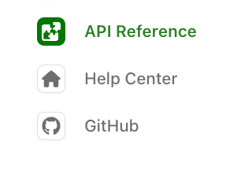

Tabs split a product or version into parallel bodies of content, each with its own sidebar. Tab variants give a single tab more than one version of its content, such as REST versus GraphQL or beginner versus advanced.

With tabs in the header, a [tab menu](#tab-menus) groups several tabs under one header tab, such as a product switcher.

Two tabs make sense when the content is unrelated, like guides and an API Reference. Variants of one tab make sense when it covers the same ground for a different reader.

## Tabs

To configure tabs:

- Declare each tab under the top-level `tabs` key with a `display-name` and an `icon`.
- Reference the tab in `navigation` with `tab:`. Each tab requires either a `layout` for its content, `variants` for [tab variants](#tab-variants), or an `href` pointing at an external URL.

<CodeBlock>
{/* <!-- vale off --> */}

```yaml title="docs.yml"
tabs: # Declare each tab
  api: 
    display-name: API Reference
    icon: puzzle # Font Awesome icon
  help:
    display-name: Help center
    icon: ./assets/icons/help-icon.svg  # Custom image file
  github:
    display-name: GitHub
    icon: brands github # Font Awesome icon
    href: https://github.com/fern-api/fern
    target: _blank # Link opens in a new tab
    
navigation: # Reference each tab by its key
  - tab: api
    layout: 
      - section: Introduction
        contents: 
          - page: My page
            path: my-page.mdx
      - api: API Reference   
  - tab: help
    layout: 
      - section: Help center
        contents: 
          - page: Contact us
            path: contact-us.mdx
  - tab: github # External link, so no layout
```
{/* <!-- vale on --> */}
</CodeBlock>

<Frame>
  
</Frame>

<Note title="Tab icons">
<Markdown src="/products/docs/snippets/icons.mdx" />
</Note>

### Tabs placement and styling

Tabs display in the left sidebar by default. Use [`theme.tabs`](/learn/docs/configuration/site-level-settings#theme-configuration) to control placement, style, and alignment.

<CodeBlock title="docs.yml">
```yaml
theme:
  tabs:
    style: bubble        # "default" (underline) or "bubble" (pill-shaped)
    alignment: center    # "left" or "center" (center only applies to header tabs)
    placement: header    # "header" or "sidebar"
```
</CodeBlock>

### Tab properties

<ParamField path="display-name" type="string" required={true} toc={true}>
  The name shown in the tab header
</ParamField>

<ParamField path="icon" type="string" toc={true}>
  <Markdown src="/products/docs/snippets/icons.mdx" />
</ParamField>

<ParamField path="slug" type="string" toc={true}>
  Custom URL slug for the tab
</ParamField>

<ParamField path="skip-slug" type="boolean" toc={true}>
  Exclude the tab slug from URLs
</ParamField>

<ParamField path="hidden" type="boolean" toc={true}>
  Hide the tab from navigation. See [Hiding content](/learn/docs/navigation/hiding-content#hiding-a-section-tab-tab-variant-or-version) for details.
</ParamField>

<ParamField path="layout" type="list" toc={true}>
  Navigation structure for the tab's content. Required unless the tab uses `variants` or `href`.
</ParamField>

<ParamField path="variants" type="list" toc={true}>
  List of [tab variants](#tab-variants). Use instead of `layout`.
</ParamField>

<ParamField path="href" type="string" toc={true}>
  External URL. When set, clicking the tab redirects to this URL. Tabs with `href` must not include `layout` or `variants`.
</ParamField>

<ParamField path="tab-menu" type="list" toc={true}>
  Turns the tab into a [tab menu](#tab-menus) of other tabs, groups, and links. A tab with a `tab-menu` has no `layout` or `variants` of its own.
</ParamField>

<ParamField path="tab-menu-column-height" type="integer | 'no-limit'" toc={true}>
  Maximum number of entries per column in this tab's menu. `no-limit` keeps a single column. Overrides [`layout.tab-menu.default-column-height`](/learn/docs/configuration/site-level-settings#layouttab-menudefault-column-height). Only applies to tabs with a `tab-menu`.
</ParamField>

<ParamField path="target" type="string" toc={true}>
  Where the link opens. One of `_blank`, `_self`, `_parent`, or `_top`.
</ParamField>

<ParamField path="changelog" type="string" toc={true}>
  Path to a [changelog](/learn/docs/configuration/changelogs) folder, relative to the YAML file where it is set (e.g., `docs.yml`)
</ParamField>

<ParamField path="viewers" type="string | list" toc={true}>
  Role-based access control for the tab
</ParamField>

<ParamField path="orphaned" type="boolean" toc={true}>
  When true, roles don't inherit from parent elements
</ParamField>

<ParamField path="feature-flag" type="string | object" toc={true}>
  Conditional display configuration
</ParamField>

<llms-only>
### Common errors

#### Tab "X" is missing from the tabs configuration.

The [`navigation`](/learn/docs/configuration/navigation) list references a tab key that isn't declared under the top-level `tabs` object. Add the tab to `tabs:` in `docs.yml` (with at least a [`display-name`](#display-name)), or update the `- tab:` reference in `navigation` to match an existing key.

```yaml title="docs.yml"
tabs: # every tab referenced in `navigation` must be declared here
  api:
    display-name: API Reference
  help:
    display-name: Help center  

navigation:
  - tab: api
    layout: [...]
  - tab: help
    layout: [...]
```

#### Tab "X" has both a href and layout. Only one should be used.

A tab entry combines [`href`](#href) with [`layout`](#layout) or [`variants`](#variants). Use `href` for external links, or `layout`/`variants` for internal content — not both.

```yaml title="docs.yml"
tabs:
  github:
    display-name: GitHub
    href: https://github.com/fern-api/fern  # external link — no `layout` or `variants`

navigation:
  - tab: github
```

#### Tab "X" is missing a href, layout, or variants.

Every tab in [`navigation`](/learn/docs/configuration/navigation) must point somewhere. Add a [`layout`](#layout), [`variants`](#variants), or [`href`](#href) to the tab entry.

```yaml title="docs.yml"
navigation:
  - tab: api
    layout:  # points the tab at internal content
      - section: Introduction
        contents:
          - page: My page
            path: my-page.mdx
```
</llms-only>

## Tab variants

To add variants to a tab:

- Replace the tab's `layout` with a `variants` list. The declaration under `tabs:` doesn't change.
- Give each variant a `title` and its own `layout`.

Variants [support RBAC](/learn/docs/authentication/features/rbac), so a variant can be limited to readers holding a given role.

```yaml title="docs.yml" startLine=16 {22-34}
tabs: 
  api: 
    display-name: API Reference
    icon: puzzle
  help:
    display-name: Help center
    icon: home
  github:
    display-name: GitHub
    icon: brands github
    href: https://github.com/fern-api/fern
    
navigation: 
  - tab: api
    layout: 
      - section: Introduction
        contents: 
          - page: My page
            path: my-page.mdx
      - api: API Reference   
  - tab: help
    variants: # Replaces this tab's layout
      - title: For developers # Each variant has its own title and layout
        layout:
          - section: Getting started
            contents:
              - page: Quick start
                path: ./pages/dev-quickstart.mdx
      - title: For product managers
        layout:
          - section: Getting started
            contents:
              - page: Overview
                path: ./pages/pm-overview.mdx
  - tab: github
```

<Frame>
  <video
    autoPlay
    muted
    loop
  >
    <source src="assets/merge-tab-variants.mp4" type="video/mp4" />
  </video>
</Frame>

### Grouped variants

A `variants` list can also hold `group` entries and `link` entries. A `group` has a header and an `items` list of variants and links. A `link` adds an external URL to the selector. When the list has groups or links, the sidebar selector shows every entry in one stacked list under its group header.

```yaml title="docs.yml"
navigation:
  - tab: sdks
    variants:
      - group: Server SDKs
        items:
          - title: Python
            default: true
            layout:
              - page: Quickstart
                path: ./pages/python/quickstart.mdx
          - title: TypeScript
            layout:
              - page: Quickstart
                path: ./pages/typescript/quickstart.mdx
      - group: Mobile SDKs
        items:
          - title: Swift
            layout:
              - page: Quickstart
                path: ./pages/swift/quickstart.mdx
      - link: Community SDKs
        href: https://github.com/example/community-sdks
```

Link entries take `link` (display text), `href`, and optional `icon` and `target`.

### Variant properties

<ParamField path="title" type="string" required={true} toc={true}>
  Display name for the variant
</ParamField>

<ParamField path="layout" type="list" required={true} toc={true}>
  Navigation structure using the same format as regular tab layouts
</ParamField>

<ParamField path="subtitle" type="string" toc={true}>
  Text displayed below the variant title
</ParamField>

<ParamField path="icon" type="string" toc={true}>
  <Markdown src="/products/docs/snippets/icons.mdx" />
</ParamField>

<ParamField path="slug" type="string" toc={true}>
  Custom URL slug for the variant
</ParamField>

<ParamField path="skip-slug" type="boolean" toc={true}>
  Exclude the variant slug from URLs
</ParamField>

<ParamField path="hidden" type="boolean" toc={true}>
  Hide the variant from navigation. See [Hiding content](/learn/docs/navigation/hiding-content#hiding-a-section-tab-tab-variant-or-version) for details.
</ParamField>

<ParamField path="default" type="boolean" toc={true}>
  When true, this variant displays by default. If not specified, the first variant in the list is used.
</ParamField>

<ParamField path="viewers" type="string | list" toc={true}>
  Role-based access control for the variant
</ParamField>

<ParamField path="orphaned" type="boolean" toc={true}>
  When true, roles don't inherit from parent elements
</ParamField>

<ParamField path="feature-flag" type="string | object" toc={true}>
  Conditional display configuration
</ParamField>

## Tab menus

A tab menu turns a header tab into a dropdown that lists other tabs, grouped into columns, along with external links. Use it to build a product switcher in the header instead of a long row of tabs. Tab menus require [tabs in the header](#tabs-placement-and-styling). With tabs in the sidebar, the menu's tabs show in a selector at the top of the sidebar instead.

To configure a tab menu:

- Declare the menu tab under `tabs` with a `tab-menu` list. Each entry is a tab, a `group` of tabs and links, or a link.
- Declare each tab in the menu only inside its menu entry, not under `tabs`.
- In `navigation`, add `- tab:` for the menu tab with no `layout` or `variants`. Its position sets where the menu sits in the header.
- In `navigation`, give each tab in the menu its own `- tab:` entry with a `layout`, or with `variants` to show a selector at the top of that tab's sidebar.

```yaml title="docs.yml"
layout:
  tabs-placement: header

tabs:
  products:
    display-name: Products
    tab-menu-column-height: 2
    tab-menu:
      - group: Platform
        tabs:
          - tab: agents
            display-name: Agents
            subtitle: Build AI agents
            icon: fa-solid fa-robot
          - tab: studio
            display-name: Studio
      - link: Status
        href: https://status.example.com
  guides:
    display-name: Guides

navigation:
  - tab: products # Menu tab: no layout or variants
  - tab: agents
    variants: # Selector at the top of the Agents sidebar
      - title: Python
        default: true
        layout:
          - page: Quickstart
            path: ./pages/agents/python.mdx
      - title: TypeScript
        layout:
          - page: Quickstart
            path: ./pages/agents/typescript.mdx
  - tab: studio
    layout:
      - page: Overview
        path: ./pages/studio/overview.mdx
  - tab: guides
    layout:
      - page: Getting started
        path: ./pages/guides/getting-started.mdx
```

URLs for tabs in a menu nest under the menu tab, for example `/products/agents/python/quickstart`. Selecting a tab with variants opens its `default: true` variant, or the first variant.

Each `group` starts a new column, and ungrouped entries share one column. A column continues into a new one after the number of entries set by the tab's [`tab-menu-column-height`](#tab-menu-column-height), or the site-wide [`layout.tab-menu.default-column-height`](/learn/docs/configuration/site-level-settings#layouttab-menudefault-column-height). Menus open on hover by default. Set [`layout.tab-menu.interact-on-click-only`](/learn/docs/configuration/site-level-settings#layouttab-menuinteract-on-click-only) to `true` to open and close them only when the tab is selected, with no animation. To restyle menus, use the [tab menu CSS selectors](/learn/docs/customization/css-selectors-reference#tab-menu-components).

### Tab menu entry properties

Tabs in a `tab-menu`, directly or inside a `group`, accept these properties. The `tab` value is the ID that the tab's `- tab:` entry in `navigation` uses.

<ParamField path="tab-menu[].tab" type="string" required={true} toc={true}>
  ID of the tab. Must match a `- tab:` entry in `navigation`.
</ParamField>

<ParamField path="tab-menu[].display-name" type="string" required={true} toc={true}>
  Name shown in the menu
</ParamField>

<ParamField path="tab-menu[].subtitle" type="string" toc={true}>
  Text displayed below the name
</ParamField>

<ParamField path="tab-menu[].icon" type="string" toc={true}>
  <Markdown src="/products/docs/snippets/icons.mdx" />
</ParamField>

<ParamField path="tab-menu[].slug" type="string" toc={true}>
  Custom URL slug for the tab
</ParamField>

<ParamField path="tab-menu[].skip-slug" type="boolean" toc={true}>
  Exclude the tab slug from URLs
</ParamField>

<ParamField path="tab-menu[].hidden" type="boolean" toc={true}>
  Hide the tab from the menu
</ParamField>

<ParamField path="tab-menu[].default" type="boolean" toc={true}>
  When true, this tab displays by default for the menu tab. If not specified, the first tab is used.
</ParamField>

<ParamField path="tab-menu[].viewers" type="string | list" toc={true}>
  Role-based access control for the tab
</ParamField>

<ParamField path="tab-menu[].feature-flag" type="string | object" toc={true}>
  Conditional display configuration
</ParamField>

A `group` entry takes `group` (the column header) and a `tabs` list of tab and link entries. A link entry takes `link` (display text), `href`, and optional `icon` and `target`.

<llms-only>
### Tab menu errors

`fern check` reports these errors for tab menus:

- A tab in a `tab-menu` has no `- tab:` entry in `navigation`, or its entry has neither `layout` nor `variants`.
- A tab is listed in more than one `tab-menu`, or is both in a `tab-menu` and under `tabs`.
- The menu tab's `navigation` entry has its own `layout` or `variants`. Put pages under each menu entry's own `- tab:` entry.
- A menu entry's tab is in `navigation`, but its menu tab isn't. Add `- tab: <menu tab>` where the menu sits in the header.
- Two tabs in one menu get the same URL slug. Give each a different `display-name` or `slug`.

`fern check` warns when a tab has a `tab-menu` but tabs aren't in the header, and when `tab-menu-column-height` is set on a tab without a `tab-menu`.
</llms-only>
