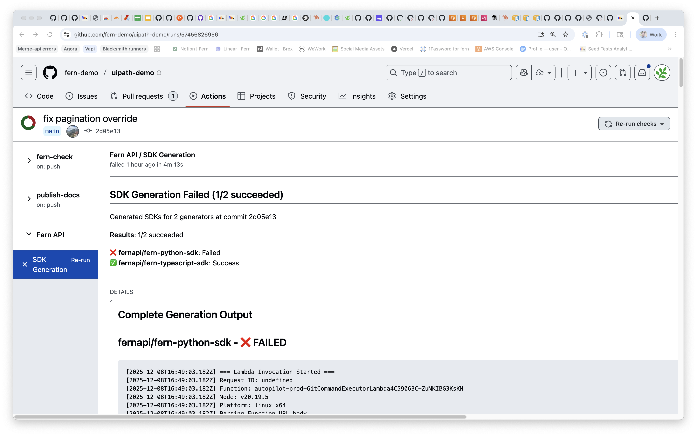

<Note title="Early Access">
Fern Autorelease is in early access. [Contact us](https://buildwithfern.com/book-demo) to get started.
</Note>

Fern Autorelease automates SDK releases end-to-end. When your API specification changes, Autorelease regenerates SDKs, determines the version bump, and publishes to package registries.

## How it works

When changes to your API specification are committed, Autorelease:

1. Regenerates SDKs for all configured languages
2. Analyzes the API diff and determines the appropriate [semantic version](https://semver.org/) bump
3. Commits to repositories, tags releases, and publishes packages
4. Updates changelogs automatically

If a release fails, Autorelease pauses and sends alerts via Slack (if configured) or the Fern Dashboard where you can review and retry.

## Setup

Autorelease requires the [Fern GitHub App](https://github.com/apps/fern-api) on your SDK repositories. Releases trigger automatically on commits to your spec repository and appear as commit status checks. No changes to your CI/CD setup are required.

`sdk-config.yml` doesn't have an Autorelease setting yet. To turn on Autorelease with `generators.yml`, see [Legacy Autorelease setup](/learn/sdks/legacy/overview/autorelease#setup).

<Frame>
  
</Frame>

### Review releases before publishing

[Set `output.github.mode: pull-request`](/learn/sdks/reference/sdk-config#github) to review releases before publishing. Autorelease opens a pull request for you to review instead of publishing directly.

```yaml title="sdk-config.yml" {6}
targets:
  - language: typescript
    output:
      delivery: github
      github:
        repository: your-org/your-repo-name
        mode: pull-request
```

### Disable autorelease

To turn off Autorelease for one generator, see [Disable autorelease](/learn/sdks/legacy/overview/autorelease#disable-autorelease) in the Legacy docs.
