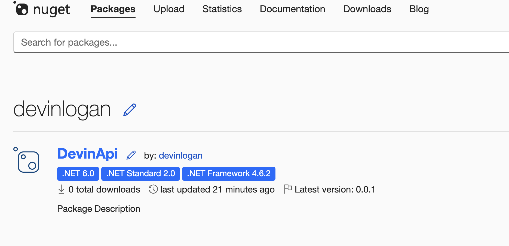
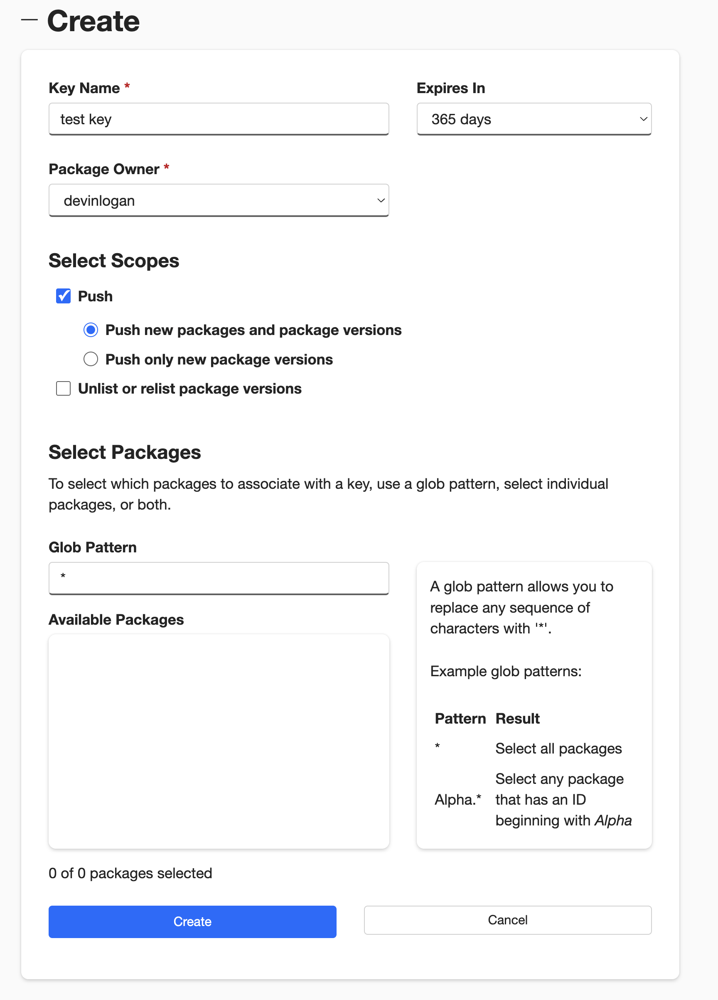
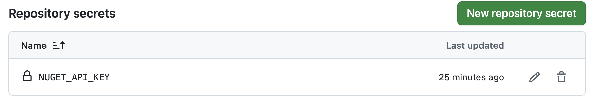
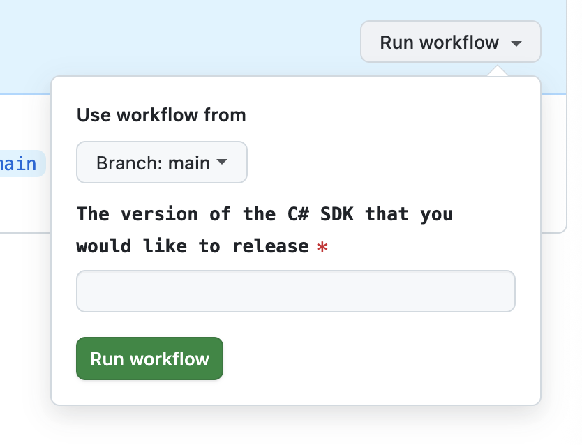

<Markdown src="/snippets/enterprise-plan.mdx"/>

Publish your public-facing Fern C#/.NET SDK to the [NuGet
registry](https://www.nuget.org/). After following the steps on this page,
you'll have a versioned package published on NuGet. To distribute the SDK
internally instead, generate to the local file system (optionally
[self-hosted](/learn/sdks/deep-dives/self-hosted)) and build a `.nupkg` with
[`fern generate --package`](/learn/cli-api-reference/cli-reference/sdk-commands#package).

<Warning title="Already publishing to NuGet?">
If you're using API key authentication, consider switching to OIDC (trusted publishing). See [Migrating from API key to OIDC publishing](#migrating-from-api-key-to-oidc-publishing) for the steps.
</Warning>

<Frame>
	
</Frame>

<Info>
	This page assumes that you have:

	* An initialized `fern` folder, a GitHub repository for your C#/.NET SDK, and a C#/.NET target in `sdk-config.yml`. See [Generating an SDK (C#/.NET)](/learn/sdks/generators/csharp/quickstart).
</Info>

<llms-only>
Before proceeding, verify the prerequisites are actually in place:

1. **Source repo with `fern/` folder**: The user should be working in their source repo, not the SDK repo. Confirm `sdk-config.yml` exists and has a C#/.NET target.
2. **C#/.NET target**: If they skipped the [C# quickstart](/learn/sdks/generators/csharp/quickstart), they need to add a `language: csharp` entry to `targets` first.

Default to OIDC authentication unless the user has a specific reason to use API key auth. OIDC is more secure and avoids managing NuGet API keys.
</llms-only>

## Configure SDK package settings

Update the C#/.NET target in `sdk-config.yml` to configure the package name and client name for NuGet publishing. Your `sdk-config.yml` [should live in your source repository](/learn/sdks/overview/project-structure) (or on your local machine), not the repository that contains your C#/.NET SDK code.

<Steps>
<Step title="Add a unique package name">

Your package name must be unique in the NuGet registry, otherwise publishing your SDK will fail.

```yaml {3-4} title="sdk-config.yml"
targets:
  - language: csharp
    package:
      packageName: your-package-name
```

</Step>
<Step title="Configure the client name">

The `generation.naming.clientName` option controls the name of the generated client class.

```yaml {5-7} title="sdk-config.yml"
targets:
  - language: csharp
    package:
      packageName: your-package-name
    generation:
      naming:
        clientName: YourClientName # must be PascalCase
```
</Step>
</Steps>

The description, authors, keywords, and repository links on your package's nuget.org listing come from the target's [`package`](/learn/sdks/reference/sdk-config#package) metadata.

## Configure GitHub publishing

Fern can automatically publish your SDK to NuGet via GitHub Actions. Set `output.delivery` to `github`, configure your repository and publishing mode, and set `output.publish.registry` to `nuget`:

<Markdown src="/products/sdks/snippets/github-publishing-mode.mdx"/>

```yaml title="sdk-config.yml" {8-15}
targets:
  - language: csharp
    package:
      packageName: your-package-name
    generation:
      naming:
        clientName: YourClientName
    output:
      delivery: github
      github:
        repository: your-org/company-csharp
        mode: push  # or "pull-request"
        branch: your-branch-name  # Required for mode: push
      publish:
        registry: nuget
```

## Configure authentication

Choose how you want to authenticate with NuGet when publishing. **OpenID Connect (OIDC) authentication is recommended** because it removes the need to manage long-lived API keys.

<AccordionGroup>
<Accordion title="OIDC authentication (Recommended)" defaultOpen={true}>

OIDC-based publishing (also known as "trusted publishing") is the most secure way to publish. With OIDC, you don't need to manage API keys — NuGet trusts your GitHub repository to publish directly via short-lived tokens scoped to your workflow.

<Steps>
<Step title="Configure OIDC">

Set `output.publish.trustedPublishing` to `true` on the C#/.NET target:

```yaml title="sdk-config.yml" {9}
targets:
  - language: csharp
    output:
      delivery: github
      github:
        repository: your-org/your-csharp-sdk
      publish:
        registry: nuget
        trustedPublishing: true
```

</Step>

<Step title="Generate your SDK">

Generate your SDK to create the GitHub Actions workflow with OIDC configuration:

```bash
fern generate --target csharp
```

This creates a `.github/workflows/ci.yml` file configured to use OIDC for NuGet publishing. The generated workflow includes:

- A `publish` job with `permissions: { contents: read, id-token: write }`
- The [`NuGet/login@v1`](https://github.com/NuGet/login) action, which exchanges a GitHub OIDC token for a short-lived NuGet API key (~1 hour)
- `dotnet nuget push` using the temporary API key from the login step


</Step>

<Step title="Authorize your repository on nuget.org">

Configure trusted publishing on nuget.org to allow your GitHub repository to publish:

1. Go to [nuget.org](https://www.nuget.org/) and click your user avatar
1. Select **Trusted Publishing** > **Create policy**
1. Fill in:
   - **Repository Owner**: Your GitHub organization or username
   - **Repository**: Your C# SDK repository name
   - **Workflow File**: `ci.yml` (filename only, without the `.github/workflows/` prefix)
1. Choose the policy owner (organization profile or personal account). The policy applies to all packages owned by that profile.

</Step>

<Step title="Set the `NUGET_USER` GitHub Actions secret">

The generated workflow requires a `NUGET_USER` secret containing your nuget.org profile name (not your email).

1. Open your SDK repository on GitHub and go to **Settings**
1. Navigate to **Secrets and variables** > **Actions**
1. Click **New repository secret**
1. Name it `NUGET_USER` and enter your nuget.org profile name
1. Click **Add secret**

</Step>
</Steps>

<Info>
For private repositories, the trust policy starts as **temporarily active for 7 days**. It becomes permanent after the first successful login binds the repository and owner IDs. Run the publish workflow within that 7-day window.
</Info>

<Accordion title="Troubleshooting">

**"Unable to authenticate" error**

Common causes:
- Workflow filename doesn't match exactly (must be `ci.yml`)
- Trusted publisher configuration on nuget.org doesn't match your repository settings
- A stale `NUGET_API_KEY` secret is interfering with OIDC authentication

**Solution:** Double-check your trusted publisher configuration on nuget.org matches your repository name and workflow filename exactly. Remove any old `NUGET_API_KEY` secret from your repository.

**Private repository limitations**

For private repositories, the trust policy is temporarily active for 7 days. It becomes permanent after the first successful login. Run the publish workflow within that window.

</Accordion>

</Accordion>

<Accordion title="API key authentication (Legacy)">

<Steps>
<Step title="Generate a NuGet API key">

1. Log into [NuGet](https://nuget.org/) or create a new account
1. Click on your profile picture
1. Select **API Keys**, then **Create**
1. Name your key
1. Select **Push > Push new packages and package versions** as the **Select Scopes** type
1. Enter `*` under **Select Packages > Glob Pattern**
		
	<Tip title="Replacing an existing NuGet package">
		If you are overriding an existing package, select the relevant
		package instead of entering `*`. 
	</Tip>
1. Click **Create**

<Frame>

</Frame>

<Warning>Save your new key — it won't be displayed after you leave the page.</Warning>

</Step>

<Step title="Add API key">

Set `output.publish.apiKey` to an environment expression naming the GitHub repository secret that holds your NuGet API key. The generated release workflow reads the key from that secret, so `sdk-config.yml` holds only the secret's name:

```yaml title="sdk-config.yml" {9}
targets:
  - language: csharp
    output:
      delivery: github
      github:
        repository: your-org/your-csharp-sdk
      publish:
        registry: nuget
        apiKey: ${NUGET_API_KEY}
```

</Step>

<Step title="Add `NUGET_API_KEY` as a GitHub Actions secret">

1. Open your repository on GitHub and go to **Settings**
1. Navigate to **Secrets and variables** > **Actions**
1. Click **New repository secret**
1. Name it `NUGET_API_KEY` and paste your NuGet API key
1. Click **Add secret**

<Frame>

</Frame>

</Step>
</Steps>

</Accordion>
</AccordionGroup>

## Publish your SDK

Your SDK will automatically be published to NuGet when you create a GitHub release with a version tag:

1. Create a GitHub release with a version tag (for example, `v1.0.0`)
1. The CI workflow will run automatically and publish to NuGet
1. View your package on nuget.org to confirm the version

<AccordionGroup>
<Accordion title="Alternative: Manual workflow dispatch">

If you prefer to trigger publishes manually from your source repository, set up a release workflow via [GitHub Actions](https://docs.github.com/en/actions).

<Steps>
<Step title="Add secret for your Fern API key">

1. Open your source repository on GitHub and go to **Settings**
1. Navigate to **Secrets and variables** > **Actions**
1. Select **New repository secret**
1. Name your secret `FERN_TOKEN`
1. Add your Fern API key. If you don't already have one, generate one by
	running `fern token`. By default, the API key is generated for the
	organization listed in `fern.config.json`.
1. Click **Add secret**

If you use API key authentication, also add a `NUGET_API_KEY` secret with your NuGet API key.

</Step>
<Step title="Set up a new workflow">

Create a CI workflow that you can manually trigger from the GitHub UI. Navigate to **Actions** > **New workflow** > **Set up workflow yourself**:

	```yaml title=".github/workflows/publish.yml" maxLines=0
	name: Publish C#/.NET SDK

	on:
	  workflow_dispatch:
	    inputs:
	      version:
	        description: "The version of the C#/.NET SDK that you would like to release"
	        required: true
	        type: string

	jobs:
	  release:
	    runs-on: ubuntu-latest
	    steps:
	      - name: Checkout repo
	        uses: actions/checkout@v4

	      - name: Install Fern CLI
	        run: npm install -g fern-api

	      - name: Release C#/.NET SDK
	        env:
	          FERN_TOKEN: ${{ secrets.FERN_TOKEN }}
	          NUGET_API_KEY: ${{ secrets.NUGET_API_KEY }} # Only needed for API key authentication
	        run: |
	          fern generate --target csharp --version ${{ inputs.version }} --log-level debug
	```

</Step>

<Step title="Regenerate and release your SDK"> 

Navigate to the **Actions** tab, select the workflow, specify a version number, and click **Run workflow**. This regenerates your SDK. 

<Frame>
	
</Frame>

<Markdown src="/products/sdks/snippets/release-sdk.mdx"/>

Once the workflow completes, view your new release by logging into NuGet and navigating to **Manage Packages**.

</Step>
</Steps>
</Accordion>

<Accordion title="Alternative: Release via CLI and environment variables">
<Steps>

<Step title="Set NuGet environment variable">

If you use API key authentication, set the `NUGET_API_KEY` environment variable on your local machine:

```bash
export NUGET_API_KEY=your-actual-nuget-api-key
```

</Step>
<Step title="Regenerate and release your SDK">

Regenerate your SDK, specifying the version:

```bash
fern generate --target csharp --version <version>
```

<Markdown src="/products/sdks/snippets/release-sdk.mdx"/>

Once the workflow completes, view your new release by logging into NuGet and navigating to **Manage Packages**.

</Step>

</Steps>
</Accordion>
</AccordionGroup>

---

## Migrating from API key to OIDC publishing

In `sdk-config.yml`, replace `output.publish.apiKey` with `trustedPublishing: true`. For the NuGet trusted publishing policy and secret cleanup, see [Migrating from API key to OIDC publishing](/learn/sdks/legacy/generators/csharp/publishing#migrating-from-api-key-to-oidc-publishing) in the Legacy docs.
