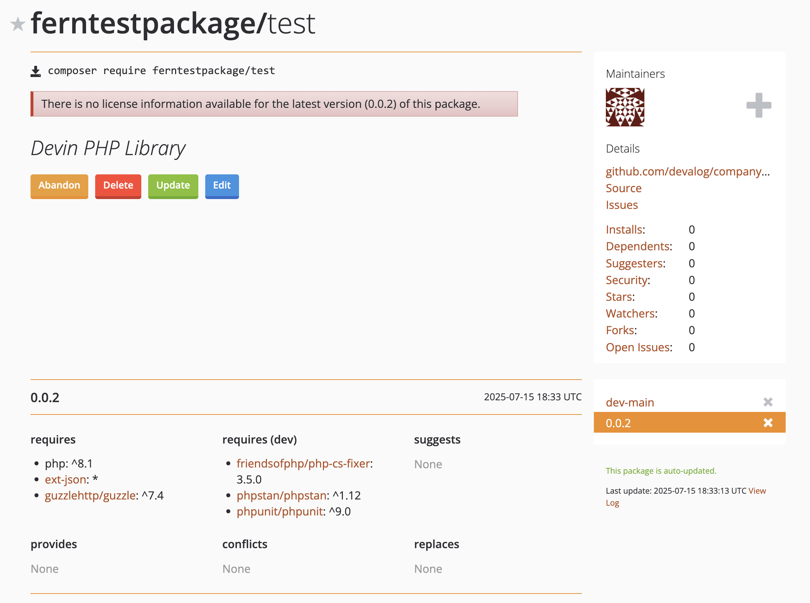
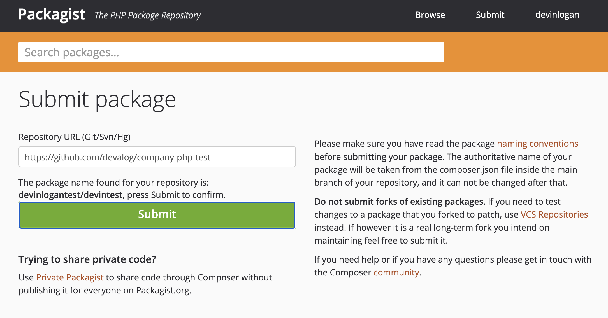
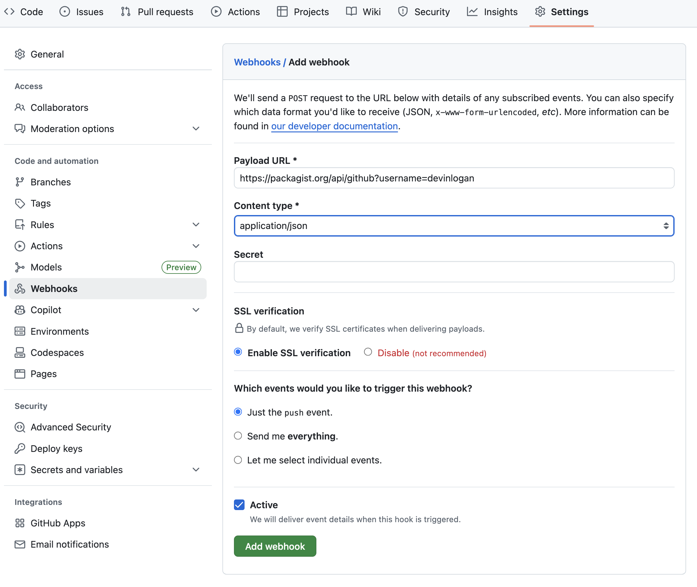

<Markdown src="/snippets/enterprise-plan.mdx"/>

Publish your public-facing Fern PHP SDK to the [Packagist
registry](https://packagist.org/). After following the steps on this page,
you'll have a versioned package published on Packagist. To distribute the SDK
internally instead, generate to the local file system (optionally
[self-hosted](/learn/sdks/deep-dives/self-hosted)) and build a Composer archive
with [`fern generate --package`](/learn/cli-api-reference/cli-reference/sdk-commands#package).

<Info>
	This page assumes that you have:

	* An initialized `fern` folder, a GitHub repository for your PHP SDK, and a PHP target in `sdk-config.yml`. See [Generating an SDK (PHP)](/learn/sdks/generators/php/quickstart).
</Info>

<Frame>
	
</Frame>

## Configure `sdk-config.yml`

PHP publishes via Git repositories, so the PHP target delivers to GitHub. Set `output.delivery` to `github` and add the path to your GitHub repository:

```yaml title="sdk-config.yml" {3-6}
targets:
  - language: php
    output:
      delivery: github
      github:
        repository: your-org/company-php
```

## Set up Packagist publishing authentication 

<Steps>
<Step title="Log into Packagist">

Log into [Packagist](https://packagist.org/login/) or [create an account with Packagist](https://packagist.org/register/).

</Step>
<Step title="Submit the Repository URL">

1. Click **Submit**.
1. Input the full URL of the repository where you generated your PHP SDK, then click **Check**.
1. Fix any errors Packagist finds in your repository, then click **Submit**. 

<Frame>
	
</Frame>

</Step>

<Step title="Configure the GitHub Hook">

Once you've submitted your URL, you'll be prompted to set up the GitHub Hook.

  1. In to your repository, go to **Settings > Webhooks**. 
  1. Select **"Add webhook"** 
  1. Set the Payload URL as `https://packagist.org/api/github?username=<your.packagist.username>`
  1. Set the content type as `application/json`
  1. Packagist autogenerates API Tokens. To find yours, go to your **Profile**. Then, add your token to the **Secret** field. 
  1. Set the trigger events as **Just the `push` event**
  1. Click **"Add Webhook"**
    <Frame>
	
</Frame>
</Step>
</Steps>

## Release your SDK to Packagist

  At this point, you're ready to regenerate your SDK and publish it on Packagist:

	```bash
	fern generate --target php --version <version>
	```
    Local machine output will verify that the release is pushed to your
    repository and tagged with the version you specified. Log back into Packagist, click on your username, and select **My packages** to see your new release. 
  
