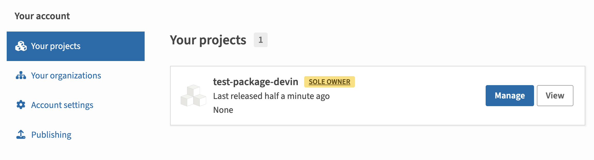
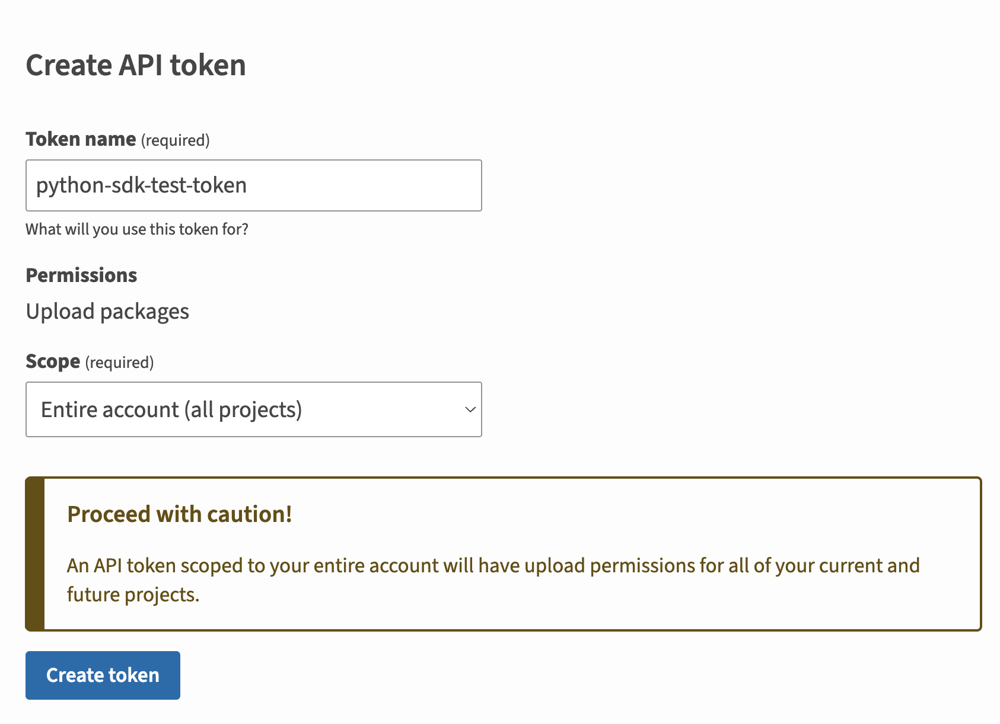
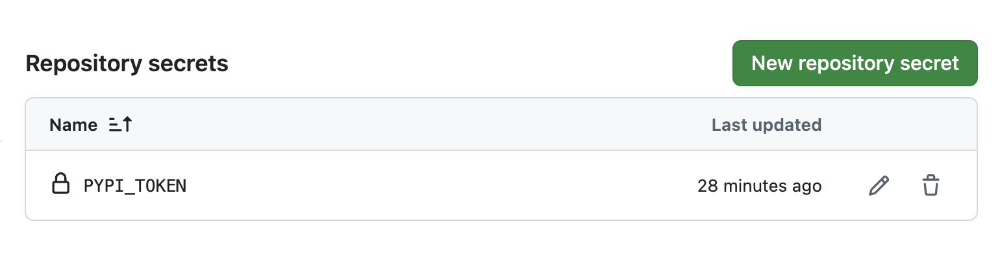
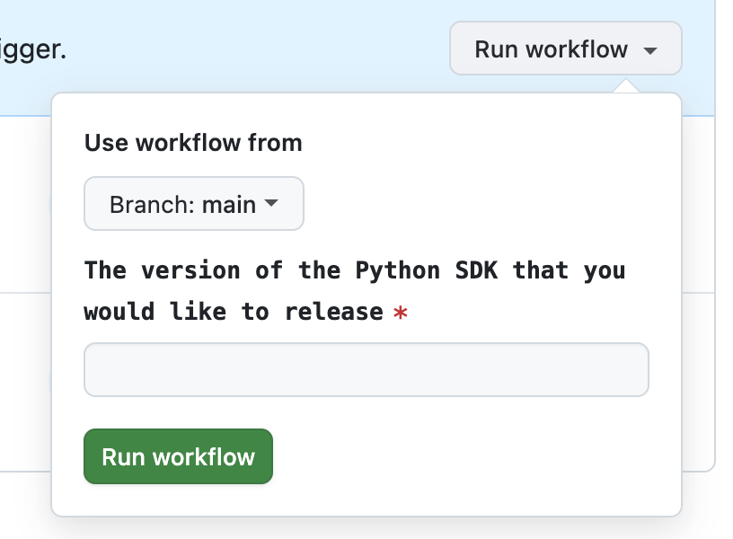

Publish your public-facing Fern Python SDK to the [PyPI
registry](https://pypi.org/). After following the steps on this page,
you'll have a versioned package published on PyPI. To distribute the SDK
internally instead, generate to the local file system (optionally
[self-hosted](/learn/sdks/deep-dives/self-hosted)) and build a wheel with
[`fern generate --package`](/learn/cli-api-reference/cli-reference/sdk-commands#package).

<Warning title="Already publishing to PyPI?">
If you're using token-based authentication, consider switching to OIDC (trusted publishing). See [Migrating from token-based to OIDC publishing](#migrating-from-token-based-to-oidc-publishing) for the steps.
</Warning>

<Frame>
	
</Frame>

<Info>
	This page assumes that you have:

	* An initialized `fern` folder, a GitHub repository for your Python SDK, and a Python target in `sdk-config.yml`. See [Generating an SDK (Python)](/learn/sdks/generators/python/quickstart).
</Info>

<llms-only>
Before proceeding, verify the prerequisites are actually in place:

1. **Source repo with `fern/` folder**: The user should be working in their source repo, not the SDK repo. Confirm `sdk-config.yml` exists and has a Python target.
2. **Python target**: If they skipped the [Python quickstart](/learn/sdks/generators/python/quickstart), they need to add a `language: python` entry to `targets` first.

Default to OIDC authentication unless the user has a specific reason to use token-based auth. OIDC is more secure and avoids managing PyPI tokens.
</llms-only>

## Configure SDK package settings

Update the Python target in `sdk-config.yml` to configure the package name and client naming for PyPI publishing. Your `sdk-config.yml` [should live in your source repository](/learn/sdks/overview/project-structure) (or on your local machine), not the repository that contains your Python SDK code.

<Steps>

	<Step title="Add a unique package name">

		Your package name must be unique in the PyPI repository, otherwise publishing your SDK to PyPI will fail.

		```yaml title="sdk-config.yml" {3-4}
		targets:
		  - language: python
		    package:
		      packageName: your-package-name
		```

	</Step>

	<Step title="Configure the client name">

		The `generation.naming.clientName` option controls the name of the generated client. This is the name customers use to import your SDK (`from your_package import YourClientName`).

		```yaml title="sdk-config.yml" {5-7}
		targets:
		  - language: python
		    package:
		      packageName: your-package-name
		    generation:
		      naming:
		        clientName: YourClientName # must be PascalCase
		```

	</Step>

	<Step title="Add PyPI metadata (optional)">

		Package metadata appears on your package's PyPI page. `keywords` support PyPI search and discovery, `documentationUrl` links to your package documentation, and `homepage` links to your project homepage. Metadata set in the top-level [`package`](/learn/sdks/reference/sdk-config#package) block applies to every target.

		```yaml title="sdk-config.yml" {5-10}
		targets:
		  - language: python
		    package:
		      packageName: your-package-name
		      keywords: ["api", "sdk", "client"]
		      documentationUrl: "https://docs.yourcompany.com"
		      homepage: "https://yourcompany.com"
		      license:
		        type: MIT
		    generation:
		      naming:
		        clientName: YourClientName
		```

	</Step>
</Steps>

## Configure GitHub publishing

Fern can automatically publish your SDK to PyPI via GitHub Actions. Set `output.delivery` to `github`, configure your repository and publishing mode, and set `output.publish.registry` to `pypi`:

<Markdown src="/products/sdks/snippets/github-publishing-mode.mdx"/>

```yaml title="sdk-config.yml" {8-15}
targets:
  - language: python
    package:
      packageName: your-package-name
    generation:
      naming:
        clientName: YourClientName
    output:
      delivery: github
      github:
        repository: your-org/your-repository
        mode: push  # or "pull-request"
        branch: your-branch-name  # Required for mode: push
      publish:
        registry: pypi
```

## Configure authentication

Choose how you want to authenticate with PyPI when publishing. **OpenID Connect (OIDC) authentication is recommended** because it removes the need to manage long-lived API tokens.

<AccordionGroup>
<Accordion title="OIDC authentication (Recommended)" defaultOpen={true}>

OIDC-based publishing (also known as "trusted publishing") is the most secure way to publish. With OIDC, you don't need to manage authentication tokens - PyPI trusts your GitHub repository to publish directly.

<Info title="Prerequisites">
- Fern Python SDK generator version `4.38.1` or later
- Fern CLI version `5.46.0` or later (only required for local generation with `--local`)
</Info>

<Steps>
	<Step title="Configure OIDC">

`sdk-config.yml` supports trusted publishing only for npm. To add `token: OIDC` with `generators.yml`, see [Legacy PyPI publishing](/learn/sdks/legacy/generators/python/publishing#configure-authentication).

</Step>

	<Step title="Generate your SDK">

	Generate your SDK to create the GitHub Actions workflow with OIDC configuration:

	```bash
	fern generate --target python
	```

	This creates a `.github/workflows/ci.yml` file that's configured to use OIDC for PyPI publishing.

	</Step>

	<Step title="Authorize your repository on PyPI">

	Configure trusted publishing on PyPI to allow your GitHub repository to publish:

	1. Navigate to your project on [PyPI](https://pypi.org/) and open **Manage** > **Publishing**
	1. Under **Add a new publisher**, select **GitHub**
	1. Fill in:
		- **Owner**: Your GitHub username or organization
		- **Repository name**: Your Python SDK repository name (e.g., `your-repository`)
		- **Workflow name**: `ci.yml`
		- **Environment name**: `pypi`

	For more details, see PyPI's [trusted publishers documentation](https://docs.pypi.org/trusted-publishers/).

	</Step>
</Steps>

<Accordion title="Troubleshooting">

**"invalid-publisher" or authentication errors**

Common causes:
- Workflow filename doesn't match exactly (must be `ci.yml`)
- Environment name on PyPI doesn't match the `pypi` environment in the generated workflow
- Trusted publisher configuration on PyPI doesn't match your repository settings

**Solution:** Double-check your trusted publisher configuration on PyPI matches your repository name, workflow filename, and environment name exactly.

</Accordion>

</Accordion>

<Accordion title="Token-based authentication">

<Steps>
<Step title="Generate a PyPI token">

1. Log into [PyPI](https://pypi.org/) or create a new account
1. Click on your profile picture and select **Account settings**
1. Scroll down to **API tokens** and click **Add API token**
1. Name your token and set the scope to the relevant projects
1. Click **Create token**

<Frame>

</Frame>

<Warning>Save your new token - it won't be displayed after you leave the page.</Warning>

</Step>

<Step title="Add token to sdk-config.yml">

Add your PyPI token to `output.publish`. PyPI API tokens use `__token__` as the username:

```yaml {15-17} title="sdk-config.yml"
targets:
  - language: python
    package:
      packageName: your-package-name
    generation:
      naming:
        clientName: YourClientName
    output:
      delivery: github
      github:
        repository: your-org/your-repository
        mode: push
        branch: your-branch-name
      publish:
        registry: pypi
        username: __token__
        password: ${PYPI_TOKEN}
```
</Step>

<Step title="Add PYPI_TOKEN as a GitHub Actions secret">

1. Open your repository on GitHub and go to **Settings**
1. Navigate to **Secrets and variables** > **Actions**
1. Click **New repository secret**
1. Name it `PYPI_TOKEN` and paste your PyPI token
1. Click **Add secret**

<Frame>

</Frame>

</Step>
</Steps>

</Accordion>

</AccordionGroup>

## Publish your SDK

Your SDK will automatically be published to PyPI when you create a GitHub release with a version tag:

1. Create a GitHub release with a version tag (for example, `v1.0.0`)
1. The CI workflow will run automatically and publish to PyPI
1. View your package on PyPI to confirm the version

<AccordionGroup>
<Accordion title="Alternative: Manual workflow dispatch">

Set up a release workflow via [GitHub Actions](https://docs.github.com/en/actions/get-started/quickstart) so you can trigger new SDK releases directly from your source repository. 

If you prefer to trigger publishes manually from your source repository, set up a release workflow via [GitHub Actions](https://docs.github.com/en/actions/get-started/quickstart).

<Steps>

<Step title="Add secret for your Fern API key">

1. Open your Fern repository on GitHub and go to **Settings** > **Secrets and variables** > **Actions**
1. Select **New repository secret**
1. Name your secret `FERN_TOKEN`
1. Add your Fern API key. If you don't already have one, generate one by
	running `fern token`. By default, the API key is generated for the
	organization listed in `fern.config.json`.
1. Click **Add secret**

If you use token-based authentication, also add a `PYPI_TOKEN` secret with your PyPI token.

</Step>

<Step title="Set up a new workflow">

Set up a CI workflow that you can manually trigger from the GitHub UI. In your repository, navigate to **Actions**. Select **New workflow**, then **Set up workflow yourself**. Add a workflow that's similar to this: 

	```yaml title=".github/workflows/publish.yml" maxLines=0
	name: Publish Python SDK

	on:
	  workflow_dispatch:
	    inputs:
	      version:
	        description: "The version of the Python SDK that you would like to release"
	        required: true
	        type: string

	jobs:
	  release:
	    runs-on: ubuntu-latest
	    steps:
	      - name: Checkout repo
	        uses: actions/checkout@v4

	      - name: Install Fern CLI
	        run: npm install -g fern-api

	      - name: Release Python SDK
	        env:
	          FERN_TOKEN: ${{ secrets.FERN_TOKEN }}
	          PYPI_TOKEN: ${{ secrets.PYPI_TOKEN }} # Only needed for token-based authentication
	        run: |
	          fern generate --target python --version ${{ inputs.version }} --log-level debug
	```

</Step>

	<Step title="Regenerate and release your SDK"> 

		Navigate to the **Actions** tab, select the workflow you just created, specify a version number, and click **Run workflow**. This regenerates your SDK. 

		<Frame>
			
		</Frame>
	
		<Markdown src="/products/sdks/snippets/release-sdk.mdx"/>

		Once the workflow completes, you can view your new release by logging into PyPi and navigating to **Your projects**.
	
	</Step>
</Steps>

</Accordion>
<Accordion title="Alternative: Release via CLI and environment variables">
<Steps>
 
	<Step title="Set PyPI environment variable">

	If you use token-based authentication, set the `PYPI_TOKEN` environment variable on your local machine:

	```bash
	export PYPI_TOKEN=your-actual-pypi-token
	```

	</Step>

	<Step title="Regenerate and release your SDK">

	Regenerate your SDK, specifying the version:

	```bash
	fern generate --target python --version <version>
	```
	<Markdown src="/products/sdks/snippets/release-sdk.mdx"/>

	Once the workflow completes, you can view your new release by logging into PyPI and navigating to **Your projects**.
    </Step>

</Steps>
</Accordion>
</AccordionGroup>

---

## Migrating from token-based to OIDC publishing

Migrating to OIDC publishing uses `generators.yml`. See [Migrating from token-based to OIDC publishing](/learn/sdks/legacy/generators/python/publishing#migrating-from-token-based-to-oidc-publishing) in the Legacy docs.
