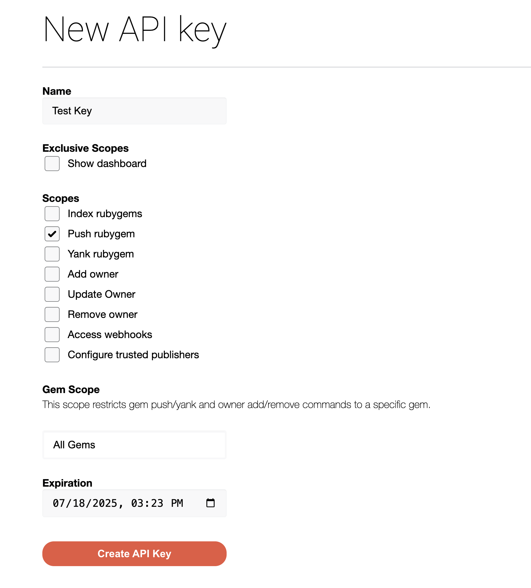

<Markdown src="/snippets/enterprise-plan.mdx"/>

Publish your public-facing Fern Ruby SDK to the [RubyGems
registry](https://rubygems.org/). After following the steps on this page,
you'll have a versioned package published on RubyGems. To distribute the SDK
internally instead, generate to the local file system (optionally
[self-hosted](/learn/sdks/deep-dives/self-hosted)) and build a gem with
[`fern generate --package`](/learn/cli-api-reference/cli-reference/sdk-commands#package).

<Info>
	This page assumes that you have:

	* An initialized `fern` folder, a GitHub repository for your Ruby SDK, and a Ruby target in `sdk-config.yml`. See [Generating an SDK (Ruby)](/learn/sdks/generators/ruby/quickstart).
</Info>

## Configure `sdk-config.yml`

Update the Ruby target in `sdk-config.yml` to configure the gem name, client name, and publishing destination. Your `sdk-config.yml` [should live in your source repository](/learn/sdks/overview/project-structure) (or on your local machine), not the repository that contains your Ruby SDK code.

<Steps>

	<Step title="Add a unique package name">

	Your package name must be unique in the RubyGems repository, otherwise publishing your SDK to RubyGems will fail.

```yaml title="sdk-config.yml" {3-4}
targets:
  - language: ruby
    package:
      packageName: your-package-name
```

	</Step>

	<Step title="Configure the client name">

	The `generation.naming.clientName` option controls the name of the generated client module.

```yaml title="sdk-config.yml" {5-7}
targets:
  - language: ruby
    package:
      packageName: your-package-name
    generation:
      naming:
        clientName: YourClientName
```

	</Step>

	<Step title="Configure GitHub delivery and RubyGems publishing">

	Set `output.delivery` to `github`, add the path to your GitHub repository, and set `output.publish.registry` to `rubygems`:

```yaml title="sdk-config.yml" {8-13}
targets:
  - language: ruby
    package:
      packageName: your-package-name
    generation:
      naming:
        clientName: YourClientName
    output:
      delivery: github
      github:
        repository: your-org/company-ruby
      publish:
        registry: rubygems
```

	</Step>

</Steps>

## Set up RubyGems publishing authentication

<Steps>

	<Step title="Log into RubyGems">

	Log into [RubyGems](https://rubygems.org/) or create a new account. 

	</Step>

	<Step title="Navigate to Account settings">

    1. Click on your profile picture
    1. Select **Settings**. 
    1. Scroll down and click on **API Keys**. 

	</Step>

	<Step title="Add New Key">

	When prompted to [create a new API key](https://rubygems.org/profile/api_keys/new):
    1. Name your key. 
    1. Under **Scopes**, select **Push rubygem**
    1. Select `All Gems` under **Gem Scope**. 
  <Tip title="Replacing an existing gem">
    If you are overriding an existing gem, you can select the relevant package instead of entering `All Gems`. 
  </Tip>
    1. Set an expiration date. 
    1. Click **Create API Key**. 

	<Warning>Save your new key –  it won’t be displayed after you leave the page.</Warning>

	<Frame>
	
	</Frame>

	</Step>


</Steps>

## Release your SDK to RubyGems

  At this point, you're ready to generate a release for your SDK.

<Steps>

	<Step title="Set RubyGems environment variable">

	On your local machine, set the `RUBYGEMS_API_KEY` environment variable to the new API key you generated earlier:

	```bash
	export RUBYGEMS_API_KEY=your-actual-rubygems-token
	```

	</Step>

	<Step title="Generate your release">

	Regenerate your SDK and publish it on RubyGems:

	```bash
	fern generate --target ruby --version <version>
	```
    Local machine output will verify that the release is pushed to your
    repository and tagged with the version you specified. Log back into RubyGems and
    navigate to **Releases** to see your new release. 
    </Step>

</Steps>